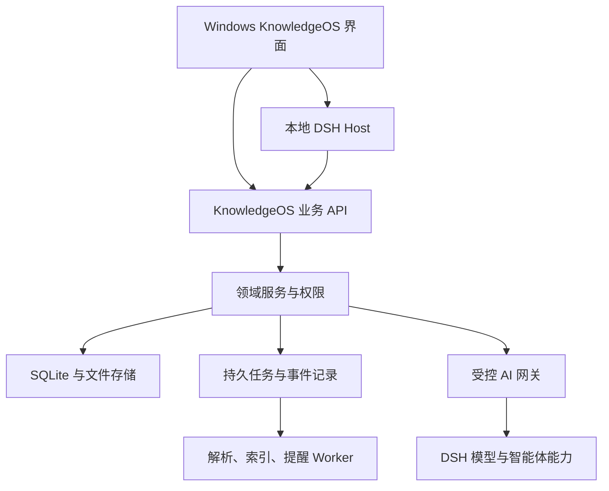

# 总体技术架构

本页是实施决策，尚未经过 M0 运行验证。真实 DSH 能力及源码位置见 [上游核对](02_DSH_CAPABILITY_AUDIT.md)。

## 1. 推荐实现

使用固定版本 DSH 的 Electron/React 桌面基础，在现有布局扩展点注册 KnowledgeOS 六个工作区。知识、训练、任务、授权等业务实现为独立领域模块；DSH 负责模型与智能体运行、工具注册和宿主集成。

第一版采用模块化单体与持久后台任务。约 10 人的目标规模没有必要先引入微服务、Kafka、Kubernetes、独立图数据库和多套向量库。资料正文放文件对象存储，业务关系放单机 SQLite 事务库；图谱先用有类型约束的节点/边表。搜索先实现可复现的中文全文检索，向量检索按真实收益增加。

### 个人模式

Windows 桌面进程启动私有 DSH Host，KnowledgeOS 领域服务和数据库在本机运行。个人身份、资料、知识、笔记、学习记录、任务、审批和讨论使用同一组领域规则。只监听本机，专用产品数据目录与其他 DSH 安装隔离。

### 协作模式

一个持续运行的 KnowledgeOS 服务是该协作空间的权威数据源，运行真实登录、项目权限、资料存取、任务裁决、评分和提醒调度。可先部署在管理员专用电脑或已有服务器；需要远程访问时配置 HTTPS。每位成员的 DSH 桌面仍只在本机运行，通过受控业务 API 访问共享服务。

个人空间可以属于本地服务或协作服务中的私人空间，界面必须显示其存储归属。协作服务里的“私人”表示普通成员和应用管理员必须按授权访问；服务器机器所有者的系统权限不能由应用 ACL 抹除。把本地私人内容带入项目需要显式发布/授权，不能因为连接服务器就自动上传整库。

**同一对象只属于一个权威服务。** 使用 `(service_id, object_id)` 标识，不在本地和远端各维护一个可自由修改的正式副本。今日计划可聚合多个来源的任务，但跨服务任务状态由各自来源确认；M4 先交付单服务内完整计划与审核，跨服务聚合必须保留来源和待同步状态，不能提前终审或重复计时。

为减少首版实现范围与数据冲突，默认一个用户的一套每日评分、强提醒与复习计划绑定一个明确的 `planning_home`。连接第二个服务不自动生成第二份正式日评分；切换规划归属是显式迁移操作，需要保存关联与历史。不把跨服务双主同步作为 M0 前置。

## 2. 运行边界

个人模式中 API、领域服务和 Worker 可以同进程部署；协作模式中它们在共享服务部署。图中的模块划分不要求一框一个进程。

共享服务优先使用专用 `knowledgeos-server` DSH profile，只挂载经清点的 WebServer、连接认证、KnowledgeOS API/权限/数据库/任务插件及必要模型能力。**禁止直接采用原生 web-app 的全量 controller 集合并分发 owner 凭据。** M0 必须证明最小 profile 可启动和拒绝非白名单路径；若具体装配能力不足，记录 ADR，拆成独立业务服务，保持所有业务 API 和领域规则不变。不能用“暂时同一个 owner”跨过鉴权门槛。

DSH 自带 token/desktop 认证与匿名安装标识不能直接作为 KnowledgeOS 的成员系统。新账户 Provider 必须从认证后的服务端会话生成主体；产品管理员也不自动成为 DSH `owner`。上游 RemoteAccess 可以复用作为入口控制，但业务层仍检查对象、版本、授权期限和派生资料访问。

上游通用 `session/attachment` 是存储级访问，普通 `/api/file` 也不是项目资料 ACL 接口。因此共享端不公开这些入口；知识原件、页图、答案、附件、导出和模型材料均经 KnowledgeOS 文件/内容接口读。详见上游的 [RemoteAccess 说明](https://github.com/deepseek-ai/deepseek-harness/blob/39163dd30f703a79079e2d2446545cff3c453738/packages/api/remote-access/README.md) 和 [Session controller 说明](https://github.com/deepseek-ai/deepseek-harness/blob/39163dd30f703a79079e2d2446545cff3c453738/packages/api/session-controller/README.md)。

## 3. 业务模块

| 模块 | 自己持有的数据与职责 | 不负责 |
|---|---|---|
| identity-access | 账户、会话、成员、授权、邀请码、权限失效 | 用 sessionId 推断用户身份 |
| library | 原件、版本、解析片段、引用、术语、知识、受约束关系 | 修改个人答题历史 |
| notes | 统一大纲节点、笔记正文、脑图布局、引用 | 删除知识库原件 |
| learning | 题目、遮挡材料、个人表现、错题、复测 | 自行改变用户方向 |
| engineering | 仓库快照、分析、诊断步骤、验证证据、案例 | 默认执行仓库脚本或写远端 |
| collaboration | 项目、任务、提交、审核、复议、终审 | 用投票替代管理员验收 |
| planning | 计划、执行时段、日评分版本、强提醒规则与账本 | 全局键鼠监控 |
| discussion | 阶段、轮次、候选稿、评审席位、意见、投票、冻结 | 认定修复真实有效 |
| operations | 插件治理、备份恢复、回收站、用量、审计 | 在日志输出令牌或私人正文 |

所有模块使用共同身份、对象引用和错误格式。模块互调领域方法，不跨模块直接改表。一个业务动作的结果与 outbox 事件同事务提交；派生索引/统计异步构建。

## 4. 数据与并发

- 业务库默认 SQLite WAL、启用外键、所有权威写入经一份服务。数据库文件位于该服务的本地磁盘，不放共享盘，不让多台客户端直接打开。
- 写事务短小；解析、模型调用、文件下载在事务外运行。重试有上限与退避；版本冲突返回 409 和当前版本，不默默覆盖。
- Worker 使用持久任务、租约、心跳、幂等键与过期租约恢复。同一文档版本的解析可按页/章节续跑；部分失败不清空已经核验的片段。
- 消费者容忍至少一次投递，靠唯一键和状态检查避免重复作答、重复审核、重复扣额度和重复提醒。发送外部通知的崩溃窗口必须记录 `unknown`，重查与去重，不宣称外部系统恰好一次。
- 业务库与 DSH 会话库分离。DSH 的 KV 文档存储适合配置/小状态；跨表约束、审核和计分不依赖它提供不存在的事务能力。

优先验证固定上游实际使用的 `node:sqlite` 驱动，在 Node、真实 Electron Host 及打包后环境分别完成持久化和事务探针。上游该存储层没有额外 Electron 适配封装，不能将源码使用视为本产品运行兼容性已通过；如实测不兼容，再选择兼容驱动并记录依据。

## 5. 文件、解析和中文检索

原件不可变，内容哈希仅用于完整性和授权范围内去重；不同用户不能通过哈希探测他人文件。文件存储键与对外对象 ID 分开，下载不暴露服务器绝对路径。

导入流水线：接收/校验 → 原件持久化 → 建立版本 → 解析任务 → 片段与页码 → 检索索引 → 质量报告。每个阶段都有状态、处理范围、错误位置和重试入口。压缩包防路径穿越、展开总量/文件数/嵌套深度超限，未知格式提示原因。

PDF 优先保留原页显示与文本层映射；Word/其他 Office 格式可复用 DSH office-kit 的转换能力，但转换输出必须转存到 KnowledgeOS 版本目录，不能依赖随 Session 结束清理的临时文件。图片和复杂表格无法可靠解析时标为待复核，不能编造文本。

730 页、约 40 MB 是必须验收的真实规模目标，不是未经测试的性能声明。页面虚拟化、解析 Worker、增量索引和按章阅读应在 M1 实现；一次性把整本 PDF 或整库正文塞进模型上下文不可接受。

中文检索默认采用可解释的全文/片段索引。M0/M1 对 SQLite FTS5 trigram、短词/术语和中英混合词做实测，缺少支持时选受维护分词/索引方案并记决策；禁止假称默认英文分词已满足中文搜索。短于 trigram 的词需要明确的短词索引或受控匹配路径。结果返回版本、页码、片段和匹配信息，回到原件必须可复现。

向量/重排是可插拔增强，不能成为基础检索与阅读的唯一依赖。加入时绑定模型版本、分块版本、来源版本、访问范围；权限先过滤，再检索/重排，并在返回、组装提示词与导出前再检查。删除或撤权后旧索引不能继续供答案使用。

## 6. AI 接入

主 Agent 使用实际可调用的 GPT 模型；保留账户/模型已有默认配置与限制，展示真实 route 和已知用量。未配置时提示 `MODEL_NOT_CONFIGURED`，不静默换 DeepSeek 或把模拟输出当 GPT 实测。

优先从 DSH 的 `ctx.llm` 与既有 Agent/工具扩展调用。知识服务实现预算、队列、取消、超时、审计与动作权限；不在全局 `llm/stream` 监听器里夹带私人资料或重写其他会话。每个模型请求的资料版本和可见内容可追溯；正式评审的投票绑定候选稿哈希。

AI 发起业务动作和人工点击同一领域服务。已授权的复习安排、草稿保存等正常执行；改变方向、分享资料、安装新插件、管理权限等需要其对应授权。调用模型不能自动扩大工具权限，外部资料内容只作为数据。

## 7. 断网、隐私和强提醒

断网保留本地草稿、执行记录和已收到结果；远端状态显示待核实。恢复时先核对身份、授权、命令幂等键和服务端版本，再提交。共享授权到期后不能依赖离线缓存继续开放受限材料；用户已合法下载的外部副本无法通过应用撤回，这一实际边界需在分享页说明。

F30 独立运行在规划归属服务的策略模块。多窗口、多设备只保留一个服务端发送账本与逻辑提醒 ID，客户端按 ID 合并；正常资料、学习记录不因 30 天过期。应用内没有关闭/停用该规则的入口，插件管理和 AI 工具也无法修改该不变量。系统休眠、应用退出或服务器停机后不承诺即时通知，恢复只重算当前状态。

## 8. 源码组织与上游升级

计划目录：`packages/domain`、`packages/storage`、`packages/api`、`packages/dsh-adapter`、`packages/client`、`packages/worker`、`packages/test-support`、`profiles/`、`tests/`。这些是本项目目录名，不冒充上游已有包。

固定上游源在 `.cache/upstream/deepseek-harness` 由锁文件重建。M0 先实现 out-of-tree 插件/Bundle + profile 的开发与打包路径；若上游构建器要求工作区集成，使用可重建的集成工作树，将本仓库扩展挂入上游工作区，所有必要变更记录为可重复补丁/装配脚本。禁用复制一份来源不明的 ASAR 作为源码基线。

业务模块尽量不直接依赖 DSH 类型；将平台差异关在 adapter 中。升级同时记录旧/新 SHA、API/持久化差异、补丁重放与受影响回归，不能用更新整个上游掩盖本项目故障。
