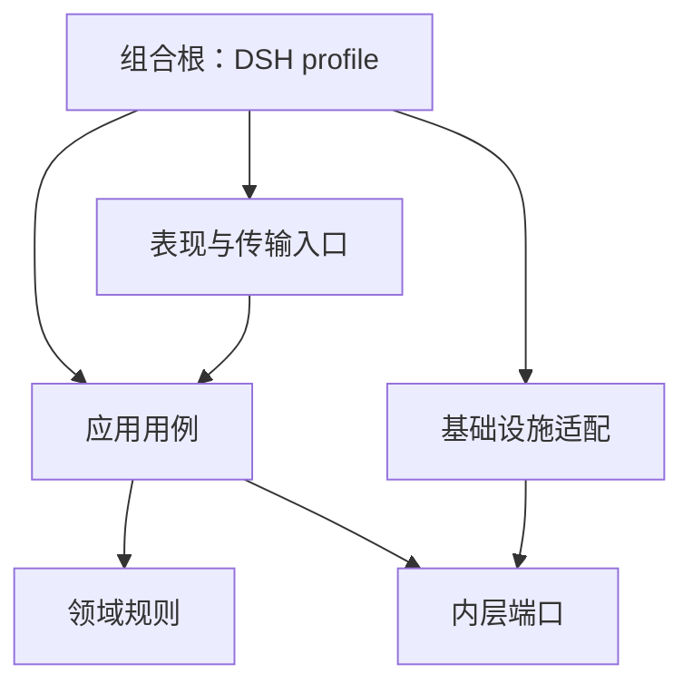

# 总体技术架构

> 当前收口：FND-003提交b1ff9ae复核需要返修，按唯一CODEX_START.md v3.1.1关闭六项问题并重新验收；FND-004未激活。后文全周期设计不扩大本轮范围。
版本：2.1，2026-11-16。本文是目标架构与适配原则，尚不代表运行验证完成。真实 DSH 能力及固定源码依据见 [上游核对](02_DSH_CAPABILITY_AUDIT.md)。

当前由 **Codex 开发已激活的 FND-003 身份切片，逐项测试并在交付后等待用户指令**。DSH 作为产品 Host 和固定上游继续使用；后续功能与完整产品审查尚未激活。当前唯一执行入口为仓库根 `CODEX_START.md`，工作单元与激活状态以执行索引所指的状态文件为准。本页描述的后续模块、层次和部署能力不构成本次全部开工指令。

## 1. 从需求确定架构

### 1.1 选择：分层的模块化单体

KnowledgeOS 的主要问题是长期数据准确性、私人权限、学习记录和审核规则的一致性；使用规模约十人，Windows 桌面优先。因此采用 **分层的模块化单体**：复用 DSH 的桌面、React 客户端及模型/工具扩展；业务用例和规则独立；一个权威业务数据库承载关联事务；文件存储承载资料原件；耗时解析和索引作为可恢复后台任务。

模块划分用来约束职责，开发中的多个智能体用来分别承担设计、实现、测试和审查。两者都不要求一个模块一个网络服务，也不要求一个智能体对应一个微服务。第一版不主动增加 Kafka、Kubernetes、分布式事务、图数据库或多套向量数据库；需要新基础设施时先提供当前功能无法满足的实测证据。

本架构由以下需求推导，不以技术流行度决定：

| 已确认需求 | 需要控制的风险 | 对应架构选择 | 每功能验证重点 |
|---|---|---|---|
| F01、F03、F31–F32：Windows、私人空间、小组协作与邀请 | 本机身份被误当项目成员，成员越权 | DSH 仅作宿主；独立认证、对象 ACL、单权威服务 | 两身份隔离、权限到期、界面与接口一致 |
| F04–F09：资料集中、版本、原件和引用 | 更新覆盖历史、转换临时文件丢失、引用漂移 | 资料身份与不可变版本分开，文件对象和事务元数据分离 | 旧引用可回读、原件完整、部分解析状态准确 |
| F06、F42：大 PDF、断网和恢复 | UI 阻塞、重复处理、崩溃丢失进度 | 后台 Worker、持久任务/checkpoint、短事务 | 部分可读、局部重试、重启续跑 |
| F10–F14：术语、长选区、快答、本体关系 | 模型生成内容缺依据，遮挡范围被截断 | 稳定文本锚点、来源版本、关系类型约束、人工确认状态 | 跨页选区、关系方向、证据失效 |
| F19–F26：个人答案、错题、能力反馈和复习 | 共用题目污染个人记录，AI 覆盖首次表现 | 共用材料与个人学习记录分开；首次答案不可覆盖 | 同题不同用户隔离、提示与独立表现区分 |
| F21：大纲与脑图双向编辑 | 两套副本不同步、误删引用原件 | 一棵内容树，布局另存；共享应用用例 | 两视图同步、版本冲突、子节点影响 |
| F15–F18、F27：仓库与工程/架构师训练 | 分析结论无源、建议被当真实修复 | 只读仓库端口、固定提交引用、过程与验证证据分开 | 路径/行范围回读、复现实测与建议区分 |
| F28–F35：计划、终审、复议、评分和强提醒 | 重复计时、改判后旧分数催促、并发重复提交 | 同一业务库与用例事务、裁决版本、确定性评分/提醒策略 | C/待审/D 阻断、改判重算、幂等与有限执行时段 |
| F37、F40：AI 操作、插件与实际模型配置 | 模型扩大权限、凭据泄露、计费/路由不真实 | AI 工具与人工操作共用用例；独立模型适配与预算 | 既有授权执行、拒绝越权、真实模型/用量记录 |
| F38–F39：分阶段评审、投票、五轮上限 | 无效票通过、旧票套新稿、模型口头冻结 | 业务状态机、候选稿哈希、确定性冻结条件 | 全席有效、ceil(2N/3)、重大阻断与上限 |
| F41、F43–F44：回收站、备份和引用失效 | 恢复旧授权、正文已删但缓存继续泄露 | 生命周期用例、依赖追踪、权限即时判定、一致性备份 | 旧分享不复活、派生内容受限、实际恢复 |

### 1.2 逻辑分层与依赖方向

| 层 | 责任 | 允许依赖 | 禁止承担 |
|---|---|---|---|
| 表现与传输入口 | React 页面、API/controller、AI 工具参数转换、进度呈现 | 应用用例的输入/输出和公开调用接口 | 在按钮、提示词或 controller 内决定终审、权限、投票通过 |
| 应用用例 | 组织一次操作：身份、权限、版本、事务、调用领域规则、返回结果 | 领域对象/规则、内层定义的存储/文件/模型/任务端口 | 导入具体 DSH 服务、React、SQLite 驱动或直接拼 SQL |
| 领域规则 | 资产版本、个人表现、任务裁决、评分、提醒、评审等业务不变量 | 领域值对象和必要的纯业务接口 | 访问 UI、网络、文件路径、DSH 全局上下文或模型来决定状态 |
| 基础设施适配 | 实现 SQLite、文件对象、检索、DSH 模型/工具、时钟和后台任务端口 | 内层端口、经核实的外部 SDK/驱动 | 将外部 SDK 类型渗入业务实体，绕过用例改表 |
| 组合根 | 通过 DSH profile/插件装配具体适配器和入口 | 上述组件的构造与注册接口 | 持有业务规则，另起绕开 DSH 启动约定的执行入口 |

端口接口由应用/领域内层定义，具体实现放在适配层。业务代码可以依赖“读取某版本资料”的端口，不依赖“从 DSH 某目录读某个文件”的 SDK 调用。部署方式改变时替换组合与适配，不重写评分或审核规则。

下面的箭头表示**代码依赖**，不是网络调用或进程部署：

随着真实功能加入，用 import 规则或已有类型构建检查防止依赖逆转。一个简单查询可以只经过入口和应用接口；无需为了符合图示给每个函数生成实体、仓储和抽象基类。

### 1.3 当前只处理 FND-003

FND-001 面板/status与FND-002持久化及R1/R2修复已验收。当前复用同一DSH loopback Host和业务库，增加可信owner初始化、业务注册登录/会话、本人方向目标与personal空间。仅新增原子v2身份迁移，保留v1 SQL/checksum/记录及未知库拒绝规则。

精确初始化页/POST要求DSH required且实际owner及本机来源；普通账号页和业务路由不依赖owner壳。业务路由使用anonymous DSH准入加Connection来源保护，再验证独立KnowledgeOS Cookie产生actor；不注册成DSH认证provider/Peer，不开放原生RPC/文件/插件能力。普通账号与产品管理员都不自动得到owner权限。

沿入口→用例/端口→SQLite/密码/会话适配的依赖方向，只增加当前真实职责。异步KDF在事务外，账号/凭据/空间同事务，业务库保持一个受控写连接。完整ACL/共享profile、模型、审计/outbox和其他业务仍各自待激活。当前精确契约与十二项测试在唯一CODEX_START及work_units中维护。

### 1.4 两种运行形态

### 个人模式

Windows 桌面进程启动私有 DSH Host，KnowledgeOS 领域服务和数据库在本机运行。个人身份、资料、知识、笔记、学习记录、任务、审批和讨论使用同一组领域规则。只监听本机，专用产品数据目录与其他 DSH 安装隔离。

### 协作模式

一个持续运行的 KnowledgeOS 服务是该协作空间的权威数据源，运行真实登录、项目权限、资料存取、任务裁决、评分和提醒调度。可先部署在管理员专用电脑或已有服务器；需要远程访问时配置 HTTPS。每位成员的 DSH 桌面仍只在本机运行，通过受控业务 API 访问共享服务。

个人空间可以属于本地服务或协作服务中的私人空间，界面必须显示其存储归属。协作服务里的“私人”表示普通成员和应用管理员必须按授权访问；服务器机器所有者的系统权限不能由应用 ACL 抹除。把本地私人内容带入项目需要显式发布/授权，不能因为连接服务器就自动上传整库。

**同一对象只属于一个权威服务。** 使用 `(service_id, object_id)` 标识，不在本地和远端各维护一个可自由修改的正式副本。今日计划可聚合多个来源的任务，但跨服务任务状态由各自来源确认；M4 先交付单服务内完整计划与审核，跨服务聚合必须保留来源和待同步状态，不能提前终审或重复计时。

为减少首版实现范围与数据冲突，默认一个用户的一套每日评分、强提醒与复习计划绑定一个明确的 `planning_home`。连接第二个服务不自动生成第二份正式日评分；切换规划归属是显式迁移操作，需要保存关联与历史。不把跨服务双主同步作为 M0 前置。

## 2. 部署与认证边界

个人模式中，知识用例、数据库与 Worker 可在同一 Host 内部署；协作模式中，它们位于一个共享业务服务，各成员本地 DSH 通过业务 API 访问。逻辑层和模块名称不决定进程数，基础开发期间不为每层分别部署服务。

共享服务优先使用专用 `knowledgeos-server` DSH profile，只挂载经清点的 WebServer、连接认证、KnowledgeOS API/权限/数据库/任务插件及必要模型能力。**禁止直接采用原生 web-app 的全量 controller 集合并分发 owner 凭据。** 该能力在身份/共享服务工作单元激活时验证，属于 M0 的阶段义务，不是 FND-001 的实现内容。验证须证明最小 profile 可启动和拒绝非白名单路径；若具体装配能力不足，记录 ADR，以独立单体业务服务承载同一用例和领域规则。不能用“暂时同一个 owner”跨过鉴权门槛，也不能因此拆成分布式微服务。

DSH 自带 token/desktop 认证与匿名安装标识不能直接作为 KnowledgeOS 的成员系统。KnowledgeOS认证适配器必须从认证后的服务端会话生成主体；本轮不将它注册为DSH的ConnectionAuthentication Provider；产品管理员也不自动成为 DSH `owner`。上游 RemoteAccess 可以复用作为入口控制，但业务层仍检查对象、版本、授权期限和派生资料访问。

上游通用 `session/attachment` 是存储级访问，普通 `/api/file` 也不是项目资料 ACL 接口。因此共享端不公开这些入口；知识原件、页图、答案、附件、导出和模型材料均经 KnowledgeOS 文件/内容接口读。详见上游的 [RemoteAccess 说明](https://github.com/deepseek-ai/deepseek-harness/blob/39163dd30f703a79079e2d2446545cff3c453738/packages/api/remote-access/README.md) 和 [Session controller 说明](https://github.com/deepseek-ai/deepseek-harness/blob/39163dd30f703a79079e2d2446545cff3c453738/packages/api/session-controller/README.md)。

## 3. 业务模块

| 模块 | 自己持有的数据与职责 | 不负责 |
|---|---|---|
| identity-access | 账户、会话、成员、授权、邀请码、权限失效 | 用 sessionId 推断用户身份 |
| library | 原件、版本、解析片段、引用、术语、知识、受约束关系 | 修改个人答题历史 |
| notes | 统一大纲节点、笔记正文、脑图布局、引用 | 删除知识库原件 |
| learning | 题目、遮挡材料、个人表现、错题、复测 | 自行改变用户方向 |
| engineering | 仓库快照、分析、诊断步骤、验证证据、案例 | 默认执行仓库脚本或写远端 |
| collaboration | 项目、任务、提交、审核、复议、终审 | 用投票替代管理员验收 |
| planning | 计划、执行时段、日评分版本、强提醒规则与账本 | 全局键鼠监控 |
| discussion | 阶段、轮次、候选稿、评审席位、意见、投票、冻结 | 认定修复真实有效 |
| operations | 插件治理、备份恢复、回收站、用量、审计 | 在日志输出令牌或私人正文 |

所有模块使用共同身份、对象引用和错误格式。跨模块协作由应用用例调用对方公开接口，不跨模块直接改表；禁止两个模块互相导入基础设施实现。跨模块的一个业务操作若需要立即一致，仍由同一业务数据库事务保证，不先拆成网络服务再补分布式事务。

业务模块按工作单元实际需要逐步建立。六个工作区是最终信息架构，当前单元只建立一个真实可操作面板；模块表不授权一次性铺开全部功能。

## 4. 事务、事件与并发

### 4.1 同步规则与提交后副作用

一次请求由应用用例组织：确认主体 → 检查对象权限与输入版本 → 执行领域规则 → 在同库事务内保存业务变化、审计和必要 outbox → 提交 → 返回已确定结果。领域事件可以在事务内形成待发布记录，真正通知其他处理者和触发外部副作用只能发生在提交成功后。

例如，管理员改判时，当前有效裁决、受影响评分的待重算标记和提醒禁止沿用旧依据的状态必须同事务生效。评分派生统计可以随后重算，但读取端和提醒调度不能在重算完成前把旧分数当有效。不能先发“改判成功”事件，再期待异步消费者最终撤销仍在生效的旧授权或旧提醒。

解析、索引、模型调用、通知投递、备份文件搬运等耗时或外部操作在事务外执行；发布结果时再次检查权限、源版本、取消状态与幂等键。当前规模使用本库 outbox/持久任务，不引入独立消息中间件。保留业务状态表与审计记录即可，不把所有读写强制改成事件溯源系统。

### 4.2 并发与恢复

- 业务库默认 SQLite WAL、启用外键、所有权威写入经一份服务。数据库文件位于该服务的本地磁盘，不放共享盘，不让多台客户端直接打开。
- 写事务短小；解析、模型调用、文件下载在事务外运行。重试有上限与退避；版本冲突返回 409 和当前版本，不默默覆盖。
- Worker 使用持久任务、租约、心跳、幂等键与过期租约恢复。同一文档版本的解析可按页/章节续跑；部分失败不清空已经核验的片段。
- 消费者容忍至少一次投递，靠唯一键和状态检查避免重复作答、重复审核、重复扣额度和重复提醒。发送外部通知的崩溃窗口必须记录 `unknown`，重查与去重，不宣称外部系统恰好一次。
- 业务库与 DSH 会话库分离。DSH 的 KV 文档存储适合配置/小状态；跨表约束、审核和计分不依赖它提供不存在的事务能力。

在持久化工作单元中优先验证固定上游实际使用的 `node:sqlite` 驱动，在可用 Node、Electron Host 环境完成持久化和事务探针；安装后环境在打包工作单元补齐。上游该存储层没有额外 Electron 适配封装，不能将源码使用视为本产品运行兼容性已通过；如实测不兼容，再选择兼容驱动并记录依据。

## 5. 文件、解析和中文检索

原件不可变，内容哈希仅用于完整性和授权范围内去重；不同用户不能通过哈希探测他人文件。文件存储键与对外对象 ID 分开，下载不暴露服务器绝对路径。

导入流水线：接收/校验 → 原件持久化 → 建立版本 → 解析任务 → 片段与页码 → 检索索引 → 质量报告。每个阶段都有状态、处理范围、错误位置和重试入口。压缩包防路径穿越、展开总量/文件数/嵌套深度超限，未知格式提示原因。

PDF 优先保留原页显示与文本层映射；Word/其他 Office 格式可复用 DSH office-kit 的转换能力，但转换输出必须转存到 KnowledgeOS 版本目录，不能依赖随 Session 结束清理的临时文件。图片和复杂表格无法可靠解析时标为待复核，不能编造文本。

730 页、约 40 MB 是必须验收的真实规模目标，不是未经测试的性能声明。页面虚拟化、解析 Worker、增量索引和按章阅读应在 M1 实现；一次性把整本 PDF 或整库正文塞进模型上下文不可接受。

中文检索默认采用可解释的全文/片段索引。中文检索工作单元激活后，对 SQLite FTS5 trigram、短词/术语和中英混合词做实测，缺少支持时选受维护分词/索引方案并记决策；禁止假称默认英文分词已满足中文搜索。短于 trigram 的词需要明确的短词索引或受控匹配路径。结果返回版本、页码、片段和匹配信息，回到原件必须可复现。

向量/重排是可插拔增强，不能成为基础检索与阅读的唯一依赖。加入时绑定模型版本、分块版本、来源版本、访问范围；权限先过滤，再检索/重排，并在返回、组装提示词与导出前再检查。删除或撤权后旧索引不能继续供答案使用。

## 6. 产品 AI 与开发智能体分开

本阶段的开发执行器是 Codex，开发团队的监督、架构、实现、测试与审查分工属于工程过程。它们不要求产品的 F38 多智能体讨论功能先完成，也不能把一次开发评审会议记录当作 F38 的实现证据。产品内部 GPT 主 Agent 的需求仍然保留，到产品 AI 工作单元才实现。

产品主 Agent 使用实际可调用的 GPT 模型；保留账户/模型已有默认配置与限制，展示真实 route 和已知用量。未配置时提示 `MODEL_NOT_CONFIGURED`，不静默换 DeepSeek 或把模拟输出当 GPT 实测。

优先从 DSH 的 `ctx.llm` 与既有 Agent/工具扩展调用。知识服务实现预算、队列、取消、超时、审计与动作权限；不在全局 `llm/stream` 监听器里夹带私人资料或重写其他会话。每个模型请求的资料版本和可见内容可追溯；正式评审的投票绑定候选稿哈希。

AI 发起业务动作和人工点击同一领域服务。已授权的复习安排、草稿保存等正常执行；改变方向、分享资料、安装新插件、管理权限等需要其对应授权。调用模型不能自动扩大工具权限，外部资料内容只作为数据。

## 7. 断网、隐私和强提醒

断网保留本地草稿、执行记录和已收到结果；远端状态显示待核实。恢复时先核对身份、授权、命令幂等键和服务端版本，再提交。共享授权到期后不能依赖离线缓存继续开放受限材料；用户已合法下载的外部副本无法通过应用撤回，这一实际边界需在分享页说明。

F30 独立运行在规划归属服务的策略模块。多窗口、多设备只保留一个服务端发送账本与逻辑提醒 ID，客户端按 ID 合并；正常资料、学习记录不因 30 天过期。应用内没有关闭/停用该规则的入口，插件管理和 AI 工具也无法修改该不变量。系统休眠、应用退出或服务器停机后不承诺即时通知，恢复只重算当前状态。

## 8. 源码组织与上游升级

目标职责可映射为 `packages/client`、`packages/application`、`packages/domain`、`packages/adapters` 以及 `profiles/`、`tests/`。API/DSH/SQLite/文件/模型适配可在 adapters 内按职责分目录，后台任务消费者通过应用用例工作；只有出现独立构建或发布需要时才拆成新包。这些是本项目的规划名称，不冒充上游已有包。

**只创建当前工作单元需要的目录和文件。** 已完成的 FND-001/FND-002 与当前 FND-003 均不要求先建齐上述所有包。每个新单元在架构检查中注明新增职责、依赖和测试位置，防止为了“分层”制造空接口或让一个模块顺带实现未激活功能。

固定上游源在 `.cache/upstream/deepseek-harness` 由锁文件重建。当前接入单元先验证 out-of-tree 插件/Bundle + profile 的实际开发装载路径，打包路径在对应单元验证；若上游构建器要求工作区集成，使用可重建的集成工作树，将本仓库扩展挂入上游工作区，所有必要变更记录为可重复补丁/装配脚本。禁用复制一份来源不明的 ASAR 作为源码基线。

业务用例和领域模块不得直接依赖 DSH、React 或 SQL 驱动类型；将平台差异关在 adapter 中，用明确的内层端口传入能力。升级同时记录旧/新 SHA、API/持久化差异、补丁重放与受影响回归，不能用更新整个上游掩盖本项目故障。

## 9. 单功能架构检查与测试同步

每次激活一个单元，架构角色先回答五个具体问题：对应哪些已确认需求；这次只改变哪个用户行为；业务规则在哪一层；数据/权限/事务受何影响；哪些测试足以证明该变化及不破坏已有功能。形成短的本单元设计与测试约定后再实现，不要求重新设计全部产品。

实现角色只在被分配的边界写代码。测试角色在开发前据约定准备正常、失败、边界和既有回归用例，在可运行版本出现后实际执行。涉及持久化就验证重启，涉及身份就验证跨用户拒绝，涉及外部模型就区分夹具与真实请求；FND-001 只验证本单元加载、读取、失败与生命周期，不假称后续业务测试已通过。

审查角色根据代码差异、实际命令、运行结果和权限/状态证据判断；模型互相赞成不代替测试。当前单元失败只在当前单元内修复与复测，不以开启另一项新功能绕过。单元交付后停止，等待下一单元明确激活；未来 Codex 全面审查修复属于后续执行阶段，不承担替代当前逐功能测试的责任。
